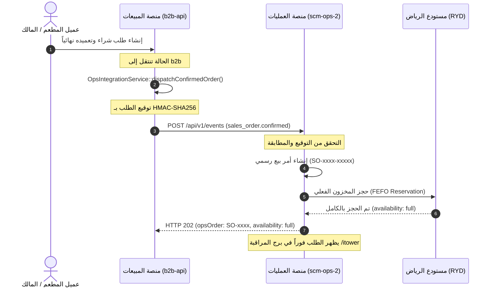

# دليل الربط والتكامل المحلي: منصة المبيعات (B2B Platform) ↔ منصة العمليات (SCM OPS)

تم إعداد وتفعيل هذا التكامل لربط مشروعي Laravel محلياً عبر خادم **Laravel Herd**، مما يتيح تدفق الطلبات المعتمدة من المطاعم والعملاء لتتحول تلقائياً إلى أوامر بيع ومستودعات في العمليات مع حجز المخزون الآلي وفق معيار **FEFO**.

---

## 1. البنية التحتية والمسارات (Architecture & Infrastructure)

| المشروع | المسار الفعلي على الجهاز | نطاق التشغيل المحلي (Herd) | الوظيفة |
| :--- | :--- | :--- | :--- |
| **منصة العمليات (SCM OPS)** | `C:\Users\a\Herd\scm-ops-2` | `http://scm-ops-2.test` | إدارة المستودعات، حجز FEFO، اللوجستيات، والشحن |
| **منصة المبيعات (B2B Sales API)** | `D:\project-customers\b2b-project\b2b\b2b-platform\b2b-platform-2\b2b-laravel-api` | `http://b2b-api.test` | بوابة المطاعم، الكتالوج، التعميد المالي والإداري |

### آلية الربط على Herd:
تم ربط مشروع المبيعات داخل مجلد Herd عبر وصلة دليل نظامية (`Directory Junction`):
```cmd
mklink /J "C:\Users\a\Herd\b2b-api" "D:\project-customers\b2b-project\b2b\b2b-platform\b2b-platform-2\b2b-laravel-api"
```
> **ملاحظة:** يتيح ذلك تشغيل كلا المشروعين بالتزامن بدون أي تعارض في المنافذ أو حاجة لأوامر `artisan serve`.

---

## 2. إعدادات الأمان ومفاتيح التشفير (HMAC Security)

التواصل بين النظامين يتم بصيغة **System-to-System** موثقة بتوقيع رقمي مشفر **HMAC-SHA256** مع التحقق من وقت الإرسال لتفادي هجمات إعادة الإرسال (Replay Attacks).

### المفتاح السري المشترك (Shared Secret):
ولّد مفتاحاً سرياً محلياً (`php -r "echo bin2hex(random_bytes(32));"`) وضعه في `.env` على الطرفين (لا يُحفظ المفتاح الحقيقي في المستودع):
```text
k1:<SHARED_HEX_SECRET>
```

### أ. ضبط ملف البيئة في العمليات (`scm-ops-2/.env`):
```env
INTEGRATION_SALES_ENABLED=true
INTEGRATION_KEYS_SALES=k1:<SHARED_HEX_SECRET>
INTEGRATION_SALES_EVENTS_URL=http://b2b-api.test/api/integration/events
INTEGRATION_SALES_CYCLE_URL=http://b2b-api.test/api/integration/run
INTEGRATION_SALES_RECONCILE_URL=http://b2b-api.test/api/integration/orders
INTEGRATION_DEFAULT_WAREHOUSE=RYD
INTEGRATION_OPPORTUNISTIC_SECONDS=120
```

### ب. ضبط ملف البيئة في المبيعات (`b2b-laravel-api/.env`):
```env
APP_URL=http://b2b-api.test
OPS_INTEGRATION_ENABLED=true
OPS_API_URL=http://scm-ops-2.test
OPS_KEY_ID=k1
OPS_KEY_SECRET=<SHARED_HEX_SECRET>
OPS_INTEGRATION_ORDERS=true
```

---

## 3. محرك التكامل في منصة المبيعات (`OpsIntegrationService.php`)

تم بناء فئة مركزية لإدارة كافة اتصالات وتوقيعات منصة المبيعات:
* **المسار:** `app/Services/OpsIntegrationService.php` في مشروع المبيعات.

### القدرات الأساسية للفئة:
1. **حساب ترويسات HMAC:** توليد ترويسات `X-B2B-System`, `X-B2B-Key-Id`, `X-B2B-Timestamp`, و `X-B2B-Signature`.
2. **فحص الاتصال (`ping`):** إرسال طلب موقّع إلى مسار الفحص `GET /api/v1/health`.
3. **إرسال الأحداث الفردية (`sendEvent`):** إرسال أي حدث بصيغة غلاف قياسي (Envelope).
4. **إرسال الدفعات الفائقة (`sendBatch`):** إرسال حتى 100 حدث معاً في طلب HTTP واحد لتسريع المزامنة.
5. **تجهيز وإرسال الطلبات المعتمدة (`dispatchConfirmedOrder`):** قراءة سلة الطلب وعميله وفرعه ومجاميعه وإرساله كحدث `sales_order.confirmed`.

---

## 4. دليل أوامر سطر الأوامر (Artisan Commands Reference)

### أوامر مشروع المبيعات (`b2b-laravel-api`):

| الأمر | الوظيفة | الاستخدام |
| :--- | :--- | :--- |
| `php artisan ops:ping` | فحص المصافحة الأمنية والاتصال مع العمليات | تشغيله للتأكد من أن السيرفرين يتعرفان على بعضهما ويردان بـ `200 OK`. |
| `php artisan ops:sync` | مزامنة العملاء والفروع والمنتجات بالكامل | ينقل المنشآت وفروعها كوجهات تسليم، والمنتجات الـ 2012 بدفعات سريعة. |
| `php artisan ops:dispatch-order {id?}` | إرسال طلب محدد أو أحدث طلب للعمليات | يختبر إرسال طلب شراء فوراً وحجز مخزونه من سطر الأوامر. |

### أوامر مشروع العمليات (`scm-ops-2`):

| الأمر | الوظيفة | الاستخدام |
| :--- | :--- | :--- |
| `php artisan scm:integration-adopt-products sales --stock=100` | ربط الأصناف وتغذية المستودع بمخزون تجريبي | يربط منتجات المبيعات بأصناف العمليات ويودع 100 حبة في مستودع الرياض (`RYD`). |
| `php artisan scm:integration-run` | تشغيل دورة تكامل يدوية | إعادة محاولة الأحداث المعلقة وإرسال التحديثات الخارجية. |

---

## 5. دورة حياة تدفق الطلب وحجز المخزون (End-to-End Workflow)



---

## 6. استكشاف الأخطاء وحلها (Troubleshooting)

### أ. خطأ `cURL error 7: Failed to connect to scm-ops-2.test`:
* **السبب:** خادم Herd متوقف، أو تم تشغيل أمر PHP داخل بيئة معزولة (Sandbox) تمنع الاتصال الشبكي.
* **الحل:** التأكد من أن خدمة Herd تعمل، وتشغيل الأوامر بصلاحية الوصول للشبكة (`BypassSandbox: true` في أدوات الأتمتة).

### ب. خطأ `CUSTOMER_UNMAPPED` أو `PRODUCT_UNMAPPED`:
* **السبب:** وصول طلب يحتوي على عميل جديد أو منتج لم تتم مزامنته مسبقاً.
* **الحل:**
  1. تشغيل `php artisan ops:sync` في المبيعات.
  2. تشغيل `php artisan scm:integration-adopt-products sales --stock=100` في العمليات.

### ج. فحص حالة برج المراقبة اللوجستي:
يمكن فتح الرابط التالي في المتصفح لمراقبة تدفق الأحداث والطلبات وحالة المخزون لحظياً:
- **برج المراقبة (Control Tower):** `http://scm-ops-2.test/itower`
- **ربط الأصناف:** `http://scm-ops-2.test/integration/products`

---

## 7. خارطة طريق الخطوات المتبقية والمستقبلية (Remaining Steps & Roadmap)

### أ. الخطوة الفورية المتبقية (Immediate Step — Frontend & Lifecycle Automation):
ربط استدعاء الإرسال التلقائي داخل مسار التعميد بمشروع المبيعات:
* **الملف المستهدف:** `app/Services/OrderWorkflowService.php` في منصة المبيعات.
* **المواضع المحددة في الكود:**
  1. **داخل دالة `approveOrderLocked`:** عند تعميد الطلب نهائياً وتحول حالته من `purch` إلى `b2b`.
  2. **داخل دالة `createOrder`:** عند إنشاء طلب مباشر من مالك المنشأة (`$direct == true`).
* **الكود البرمجي المستخدم للربط:**
  ```php
  // إرسال الطلب فوراً إلى منصة العمليات اللوجستية وحجز المخزون
  try {
      app(\App\Services\OpsIntegrationService::class)->dispatchConfirmedOrder($order);
  } catch (\Throwable $e) {
      \Illuminate\Support\Facades\Log::error("Failed auto-dispatching order {$order->id} to OPS: " . $e->getMessage());
  }
  ```
* **الأثر والنتيجة:** تصبح دورة الطلب آلية 100%؛ بمجرد نقر زر "تعميد الطلب" في لوحة التحكم أو التطبيق، يطير الطلب فوراً في أجزاء من الثانية إلى منصة العمليات ويحجز المخزون تلقائياً في المستودع دون الحاجة لتشغيل أي أمر في سطر الأوامر.

---

### ب. الخطوات المستقبلية التوسعية (Future Enhancements):

#### 1. المسار العكسي لتحديثات العمليات (Reverse Callbacks & e-POD):
* **الوصف:** عندما يقوم فريق المستودعات بتجهيز الطلب وتحميله على الشاحنة وتسليمه عبر السائق مع إثبات التسليم الإلكتروني (e-POD).
* **التنفيذ:**
  - توفير مسار `POST /api/integration/events` في منصة المبيعات (المُعرّف بالفعل في `INTEGRATION_SALES_EVENTS_URL`).
  - استقبال أحداث خروج الشحنة (`shipment.dispatched`) وإثبات التسليم (`delivery.confirmed`).
  - تحديث حالة الطلب في منصة المطاعم آلياً من "قيد التجهيز" إلى "تم الشحن" ثم "تم الاستلام".

#### 2. دورات المزامنة التلقائية الدورية (Scheduled Reconciliation):
* **الوصف:** تشغيل دورة فحص أوتوماتيكية دورياً للتأكد من عدم وجود أي أحداث عالقة بين النظامين في حال انقطاع الشبكة المؤقت.
* **التنفيذ:**
  - إضافة الأمر `scm:integration-run` في جدولة المهام (`routes/console.php` في العمليات) ليعمل كل 5 دقائق:
    ```php
    Schedule::command('scm:integration-run')->everyFiveMinutes();
    ```


